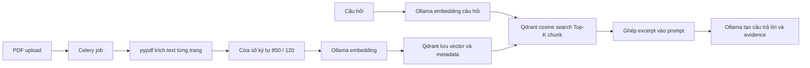

# Chunking E2E trong project

Tài liệu này mô tả cách văn bản được chia thành chunk từ lúc nạp dữ liệu đến lúc truy xuất và đánh giá.
Các con số dưới đây là số ký tự Python (`len(text)`), không phải token của embedding hoặc LLM.

## Tóm tắt các luồng

| Luồng | Mã nguồn | Cách chia | Kích thước / overlap mặc định | Đơn vị truy xuất |
|---|---|---|---|---|
| PDF qua API đang phục vụ người dùng | `src/server.py` | Cửa sổ ký tự có ưu tiên ngắt ở dòng mới | 850 / 120 | Chunk trong Qdrant |
| TechQA offline để chọn retrieval champion và chấm generation | `scripts/techqa_retrieval.py` | Cửa sổ ký tự cố định | 850 / 150 | Xếp hạng chunk, giữ chunk tốt nhất của mỗi tài liệu |
| TechQA index cho bài đo tải API | `scripts/techqa_index.py` | Cửa sổ ký tự có ưu tiên ngắt ở dòng mới | 850 / 120 | Chunk trong Qdrant |
| `RAGPipeline` tái sử dụng | `src/rag/splitting.py` | LangChain `RecursiveCharacterTextSplitter` | 512 / 64 | Chunk trong retriever được cấu hình |

Không có semantic chunking hoặc token-based chunking trong đường upload PDF đang chạy.
`ChunkerFactory` ở `src/rag/chunking.py` nhận các nhãn `sentence`, `token`, `semantic` và `window`, nhưng hiện tất cả đều tạo cùng một `LangChainSplitter`; các nhãn này chưa triển khai bốn thuật toán riêng.

## 1. PDF upload đến câu trả lời



### Nạp và chia trang PDF

`POST /api/documents/upload` nhận file PDF, lưu file tạm và trả `taskId` với trạng thái `queued`.
Celery worker gọi `_ingest_pdf()` trong `src/server.py`; bản thân request upload chưa hoàn tất việc index.
`pypdf.PdfReader` trích text theo từng trang và bỏ qua trang không có text trích xuất được.
Mỗi trang được chia độc lập, vì vậy một chunk không băng qua ranh giới hai trang.
PDF chỉ chứa ảnh mà không có text trích xuất sẽ bị từ chối; luồng này chưa có OCR.

Hàm `_text_chunks()` dùng `RAG_CHUNK_SIZE=850` và `RAG_CHUNK_OVERLAP=120` nếu không có cấu hình khác.
Nó `strip()` text của trang, lấy tối đa 850 ký tự từ vị trí bắt đầu, rồi tìm ký tự xuống dòng cuối cùng trong cửa sổ.
Nếu dòng mới đó nằm sau nửa đầu cửa sổ, chunk kết thúc ở dòng mới; nếu không, chunk kết thúc ở giới hạn 850 ký tự.
Chunk được `strip()` thêm một lần và chunk rỗng bị bỏ qua.
Vị trí bắt đầu tiếp theo là `max(start + 1, end - overlap)`, nên các cửa sổ chồng lấn về vị trí tối đa 120 ký tự theo mặc định.
Độ dài phần trùng lặp nhìn thấy trong hai chunk có thể ít hơn 120 vì khoảng trắng đầu hoặc cuối bị loại bỏ.
Đây là ưu tiên ngắt theo **dòng mới**, không phân tích cấu trúc đoạn văn hay ý nghĩa câu.

Mỗi chunk có `document_id`, tên file, số trang bắt đầu từ 1, `chunk_index` trong trang, `char_start` và text.
`char_start` là vị trí trong text trang sau khi `strip()`, không phải byte offset trong PDF gốc.
ID chunk là UUID5 ổn định theo document ID, trang, chỉ số chunk và hash nội dung chunk.
Text chunk được gửi đến endpoint embedding của Ollama theo model `OLLAMA_EMBED_MODEL`, mặc định `qwen3-embedding:0.6b`.
Vector và metadata được upsert vào collection Qdrant `QDRANT_COLLECTION`, mặc định `prompt_engineering_documents`, với khoảng cách cosine.
Khi job hoàn tất, API trả `documentId` và `chunkCount`; manifest tài liệu cũng được cập nhật.

### Truy vấn

`POST /api/query` nhúng câu hỏi bằng cùng embedding model rồi tìm vector trong Qdrant.
`topK` mặc định là 5 và có thể đặt từ 1 đến 50 cho mỗi request.
`datasetId` hoặc `documentIds` giới hạn tài liệu được tìm trên server.
Top-K ở đây đếm **chunk**, không đếm tài liệu; nhiều chunk có thể đến từ cùng một PDF.
API gửi text của các chunk tìm được vào prompt của `OLLAMA_CHAT_MODEL`, mặc định `qwen3.5:4b`.
Phản hồi gồm `answer` và `evidence` với `documentId`, excerpt, điểm liên quan và locator theo trang/ký tự.
`verified` trong evidence là trường phản hồi của API, không phải kết quả kiểm chứng từng claim bởi judge.

### Chạy E2E trên máy Windows

Bạn cần một PDF có text trích xuất được, Ollama đang chạy với `qwen3-embedding:0.6b` và `qwen3.5:4b`, cùng Docker Compose.
Kiểm tra model bằng `ollama list`; hướng dẫn Ollama chi tiết ở [local_ollama.md](local_ollama.md).
Thay đường dẫn PDF ở ví dụ bằng file thực tế trên máy.

```powershell
ollama list
docker compose up -d --build rag-api rag-worker

$pdfPath = 'D:\path\to\document.pdf'
if (-not (Test-Path -LiteralPath $pdfPath)) { throw "PDF not found: $pdfPath" }

$upload = curl.exe -sS -F "file=@$pdfPath;type=application/pdf" `
  'http://localhost:8000/api/documents/upload' | ConvertFrom-Json
$upload

for ($attempt = 0; $attempt -lt 60; $attempt++) {
  $job = Invoke-RestMethod "http://localhost:8000/api/ingest-jobs/$($upload.taskId)"
  if ($job.status -in @('completed', 'failed')) { break }
  Start-Sleep -Seconds 2
}
if ($job.status -ne 'completed') { throw "Ingestion status: $($job.status)" }
$job.document | Select-Object documentId, name, chunkCount

$body = @{
  question = 'Tài liệu này nói gì về chủ đề chính?'
  documentIds = @($job.document.documentId)
  topK = 5
} | ConvertTo-Json -Depth 5
$result = Invoke-RestMethod -Method Post -Uri 'http://localhost:8000/api/query' `
  -ContentType 'application/json' -Body $body
$result.answer
$result.evidence | Select-Object documentId, locator, excerpt, relevance
```

Một run thành công có `chunkCount > 0`, `evidence` chứa chunk của `documentId` vừa nạp, và câu trả lời được tạo từ các excerpt đó.
Nếu thay embedding model, collection Qdrant hiện tại phải tương thích với kích thước vector của model mới; không thể suy ra chất lượng từ một truy vấn thử duy nhất.
Biến `RAG_CHUNK_SIZE` và `RAG_CHUNK_OVERLAP` được đọc trong cả API và worker; khi dùng Compose, cần truyền cùng giá trị cho cả hai service và tái index tài liệu để cấu hình mới có hiệu lực nhất quán.

## 2. TechQA offline: chunk, retrieval và generation evaluation

TechQA offline đọc `eval_data/corpus.jsonl` gồm 100 tài liệu và `eval_data/eval_questions.json` gồm 20 câu hỏi với một gold document ID cho mỗi câu.
`TechQARetriever` chia phần `text` của từng tài liệu thành cửa sổ 850 ký tự, bước tiến 700 ký tự, tức overlap 150 ký tự.
Luồng này không tìm dòng mới để điều chỉnh ranh giới và không `strip()` phần text được lưu trong chunk, trừ việc bỏ chunk chỉ có khoảng trắng.
Nó gắn `title` và hai dòng mới trước mỗi passage khi tạo text để BM25 hoặc embedding sử dụng.
Vì thế text đưa vào retriever có thể dài hơn 850 ký tự sau khi thêm title.
ID passage có dạng `<doc_id>::chunk-0000`, `<doc_id>::chunk-0001`, v.v.

Retriever xếp hạng các passage bằng BM25, dense embedding hoặc hybrid RRF.
Nó quét danh sách passage đã xếp hạng, chỉ giữ passage đứng cao nhất của mỗi tài liệu và trả tối đa K tài liệu.
Hit Rate, Precision, Recall, MRR và nDCG so các **document ID** trả về với gold document ID, rồi lưu metric và ID từng case trong MLflow.
Các metric này xác nhận việc tìm đúng tài liệu; chúng không đo trực tiếp việc passage có chứa đủ câu trả lời hay ranh giới chunk có tối ưu không.

File `eval_data/results/techqa_retrieval_champion.json` lưu cấu hình được chọn cùng dataset fingerprint và run ID.
Generation evaluator đọc file này, dựng lại retriever, tạo câu trả lời bằng Ollama và dùng OpenRouter judge chấm chất lượng.
Context generation bắt đầu từ passage đã truy xuất và có thể thêm các đoạn trích khác từ **cùng tài liệu được chọn** theo từ khóa câu hỏi trong giới hạn ký tự.
Vì vậy điểm generation không thể được diễn giải là chất lượng của riêng passage 850 ký tự ban đầu.
Các lệnh chạy và model cần thiết nằm trong [techqa_evaluation.md](techqa_evaluation.md).

Kết quả TechQA đã lưu: dense `qwen3-embedding:0.6b` tại Top-K 1 đạt 1.000 ở cả năm metric retrieval trên 20 câu hỏi cung cấp.
Đây là kết quả trên cùng tập câu hỏi đã dùng để chọn champion, chưa phải phép đo trên holdout độc lập.

## 3. TechQA index cho bài đo tải API

`scripts/techqa_index.py` tạo một collection Qdrant riêng từ cùng corpus TechQA.
Nó dùng cách chia theo dòng mới giống API, mặc định 850/120, và lưu `document_id`, `chunk_index`, `char_start`, text, hash dataset và tên embedding model trong payload.
Collection name phụ thuộc vào hash corpus, model embedding, kích thước chunk và overlap để tránh dùng nhầm một index khác cấu hình.
`scripts/run_techqa_load.ps1` index collection này rồi gửi request vào API.
Do cách chia 850/120 và đơn vị Top-K theo chunk khác luồng offline 850/150 với Top-K theo tài liệu, kết quả offline không tự động là kết quả của API đang phục vụ.

## 4. `RAGPipeline` tái sử dụng

`src/rag/pipeline.py` gọi `LangChainSplitter` khi `ingest_documents()` hoặc `ingest_path()`.
Splitter dùng `RecursiveCharacterTextSplitter` của `langchain-text-splitters` với cấu hình mặc định `chunk_size=512`, `chunk_overlap=64` từ `PipelineConfig`.
Nó giữ metadata của nguồn, thêm `chunk_index` và `chunk_id` cho mỗi phần.
Đường upload PDF trong `src/server.py` không gọi splitter này.
Đừng lấy 512/64 để mô tả chunking của API hoặc lấy điểm TechQA 850/150 để kết luận rằng 512/64 đã được đánh giá.

## 5. Cách đánh giá thay đổi chunking

Khi đổi size, overlap hoặc cách ngắt, hãy tạo index mới từ cùng corpus và so sánh trên cùng bộ câu hỏi có gold IDs.
Ghi chính xác thuật toán chunking, kích thước, overlap, hash corpus, embedding model, Top-K, metric retrieval và artifact từng câu vào MLflow.
Nếu mục tiêu là cải thiện câu trả lời, tiếp tục đo generation trên holdout độc lập và giữ judge, prompt, generator cố định giữa các biến thể.
Một điểm retrieval theo document ID cao không chứng minh passage đủ thông tin để trả lời.
