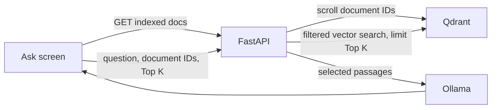

# Query Indexed Documents

## Outcome and boundary

Ask can query one or more documents that currently have vectors in Qdrant, with a user-selected Top K from 1 to 50. Upload and document-history behavior are unchanged.

## Decisions

- The picker defaults to every document currently indexed in Qdrant.
- A dedicated API endpoint returns only IDs present in the active Qdrant collection.
- Top K defaults to 5 and limits retrieved passages, not uploaded files or whole documents.
- Empty selection is invalid; an empty index returns no selectable records.
- Query selection and Top K are request-scoped and are not persisted.

## Flow

## State and recovery

There is no durable feature lifecycle: each query is independent. If document listing fails, show a retryable error and disable Run. If no documents are indexed, show the empty state. Invalid document selection or Top K is rejected before retrieval.

## Acceptance criteria

- Indexed-document API omits catalog records with no Qdrant points.
- Ask defaults to all indexed documents and supports selecting a subset or clearing selection.
- Ask sends selected IDs and Top K; retrieval applies both as server-side filters/limits.
- Top K outside 1-50 is rejected; existing callers without these fields keep the configured retrieval default.
- Query response provenance includes selected document IDs.
