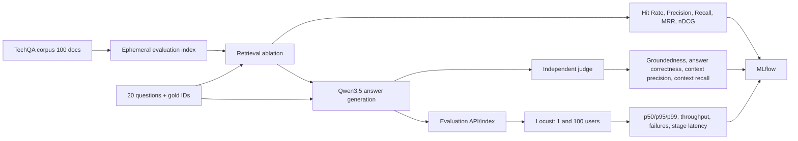
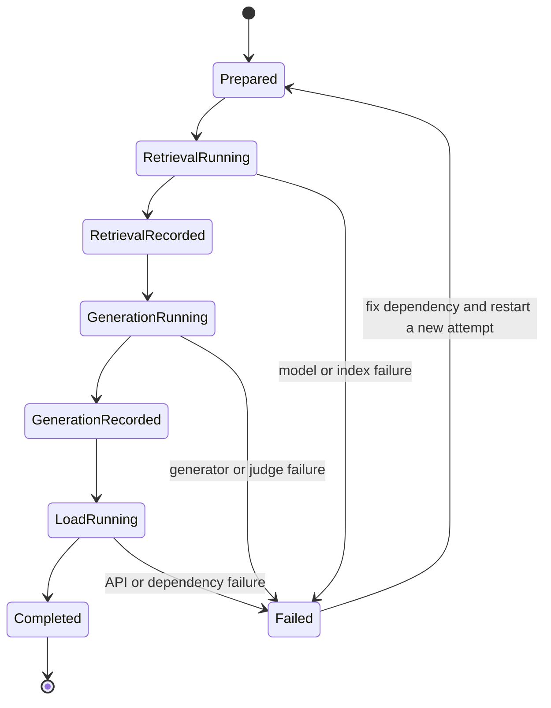
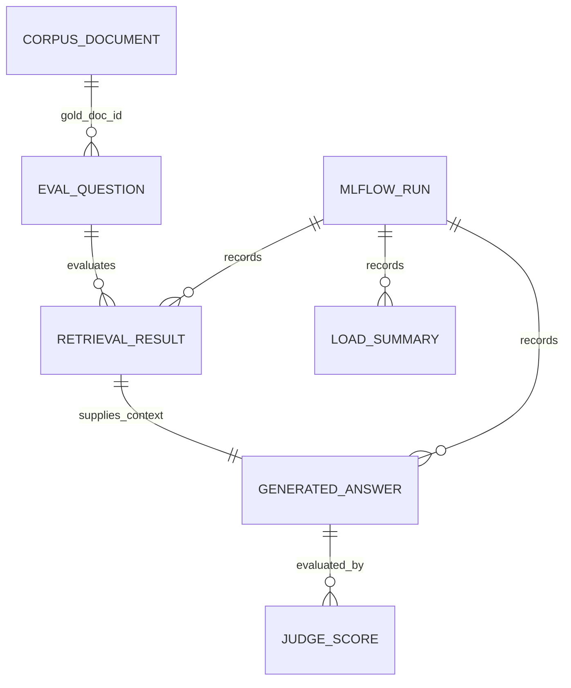

# TechQA evaluation workflow

## Outcome and boundary

Replace the former evaluation inputs with the lightweight TechQA corpus and produce MLflow-tracked evidence for retrieval ablation, generation quality, and query load at one and one hundred concurrent users.

The workflow evaluates the 20 supplied questions against the supplied 100-document corpus.
It does not replace the application's persistent Qdrant production collection or delete `data/`.

## Confirmed decisions

- The authoritative source inputs remain at `D:\Downloads\TechQA\rag_eval_light\`.
- The workspace receives copies only: `eval_data\corpus.jsonl` and `eval_data\eval_questions.json`.
- `corpus.jsonl` contains 100 documents and all 20 question `gold_doc_id` values occur exactly once.
- The installed local embedding model is `qwen3-embedding:0.6b`.
- The installed local generation model is `qwen3.5:4b`.
- The remote judge uses OpenRouter with `inclusionai/ling-3.0-flash-fin:free` as the primary model.
- The other published IDs are `stealth/space-bunny-alpha` and `nvidia/nemotron-3.5-lightning:free`; they can be evaluated in separate runs.
- This delivery sets up runnable experiments and uses only lightweight checks.
- Every real experiment must be tracked in MLflow with dataset fingerprint, model names, parameters, per-case results, and run artefacts.
- No synthetic scores, fallback documents, or inferred ground truth may be reported as a measurement.

## Proposed evaluation contract

## Experiment states

Each attempt has a unique MLflow run ID.
The dataset fingerprint and model revisions identify comparable attempts.
Failed attempts remain recorded as failures and never receive fabricated metrics.

## Data relationships

## Edge-case and recovery contract

- Invalid JSON, duplicate document IDs, missing gold IDs, or a source-file hash mismatch fail before indexing.
- A missing local model, Ollama outage, unavailable MLflow, or unavailable API aborts the current run with an explicit error.
- Offline retrieval and generation evaluations build an in-memory index from the copied TechQA corpus.
- The later live API load test uses a dedicated Qdrant collection whose name includes the dataset fingerprint.
- A 100-user run starts only after the one-user run passes and all service dependencies are healthy.
- Load requests have bounded duration and timeout; failures count in the reported error rate.
- Raw questions, answers, source text, prompts, credentials, and tracebacks are excluded from telemetry.

## Acceptance criteria

- [ ] Both imported files match their source SHA-256 hashes.
- [ ] Validation proves 20 questions, 100 unique documents, and 20 present gold document IDs.
- [ ] Retrieval ablation includes at least the local Qwen embedding baseline and a documented configuration matrix, with the five deterministic metrics recorded in MLflow.
- [ ] Generation evaluation records per-case answer quality and context quality, using a judge explicitly distinct from the generator or documents why an exception is necessary.
- [ ] One-user and 100-user runs record p50/p95/p99, throughput, error rate, and embedding/retrieval/generation timing in MLflow.
- [ ] Load results identify the API's dense Qdrant/Qwen serving configuration, since that API does not yet serve an arbitrary offline retrieval champion.
- [ ] Results distinguish measured evidence from limitations and do not claim an unmeasured production improvement.

## Judge configuration

An OpenRouter API key is configured in the local `.env` file.
The model IDs above are the published OpenRouter IDs.
The supplied text concatenated the Space Bunny and NVIDIA IDs, so each published ID is documented separately.
Free endpoints do not guarantee schema-enforced JSON responses; the evaluator must parse and validate responses and fail clearly after bounded retries.

## Non-goals

- No deletion or mutation of `data/`, uploads, or the application Qdrant collection.
- No claim that 20 queries establish statistical significance for a production rollout.
- No concurrent-upload benchmark in this phase.
